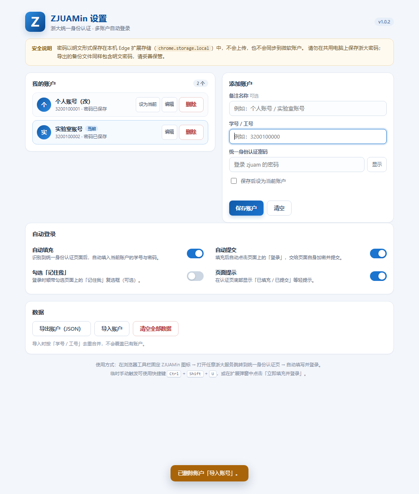
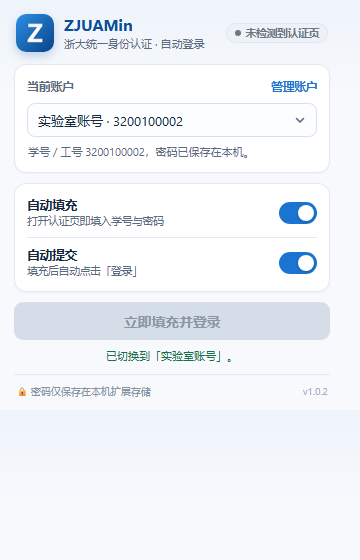
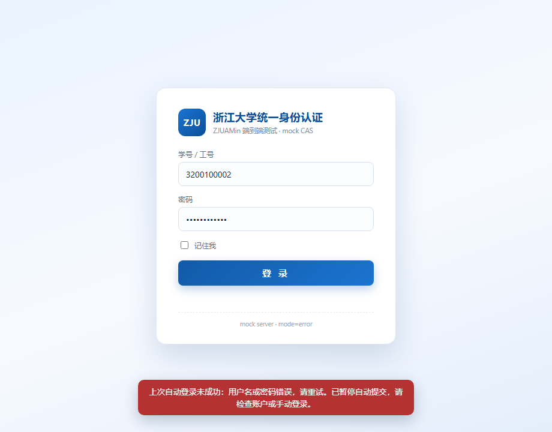
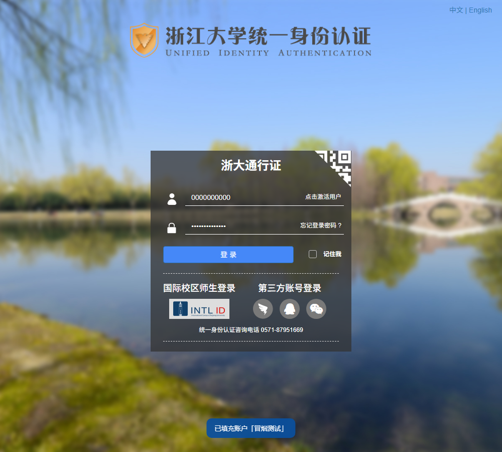

# ZJUAMin — 浙大统一身份认证自动登录

一个只做一件事的 Edge / Chromium 扩展：**当页面是浙江大学统一身份认证（`https://zjuam.zju.edu.cn/`）时，自动填入你选定的账户的学号 / 工号与密码，并自动点击「登录」。**

支持配置多个账户、随时切换「当前生效账户」。不用再记、也不用再手输那串密码。



## 功能

- **自动填充 + 自动提交**：识别到 zjuam 登录页后，填入当前账户的学号 / 工号与密码，并在约 0.15 秒后自动点击页面上的「登录」。加密与提交完全交给学校页面自己的脚本完成（见「工作原理」），扩展不碰密码加密逻辑。
- **多账户**：最多保存 20 个账户，备注名 + 学号 / 工号 + 密码；按学号自动去重。
- **选择生效账户**：在弹窗下拉框、设置页「设为当前」都能切换；切换后无需刷新，登录页会按新账户重新填充。
- **开关可调**：自动填充、自动提交、勾选「记住我」、页面提示，四个开关独立控制。
- **防呆设计**：
  - 页面需要验证码时**只填不交**，并提示你输入验证码；
  - 上一次登录失败（页面出现错误提示）时**暂停自动提交**，避免连续错误把账号锁掉；该暂停会跨标签页记住 30 分钟；
  - 同一标签页短时间内不重复点击「登录」。
- **手动触发**：扩展弹窗「立即填充并登录」，或快捷键 `Ctrl+Shift+U`（可在 `edge://extensions/shortcuts` 修改）。
- **账户导入 / 导出**：导出为 JSON 便于备份或换机迁移，导入时按学号去重合并。

## 安装（Edge）

1. 下载本仓库，或解压 `dist/zjuamin-1.0.2.zip` 到任意固定目录（例如 `D:\Extensions\ZJUAMin`）。
2. 在 Edge 地址栏打开 `edge://extensions/`。
3. 打开左下角「开发人员模式」。
4. 点击「加载解压缩的扩展」，选择包含 `manifest.json` 的那个文件夹（不是它的上级目录）。
5. 建议点击扩展图标旁的「图钉」，把 ZJUAMin 固定到工具栏。

> 也适用于 Chrome / 其他 Chromium 内核浏览器（`chrome://extensions/` 同样操作）。

## 首次使用

1. 点击工具栏的 ZJUAMin 图标 → 「添加第一个账户」（或「管理账户」）。
2. 填写备注名（可选，例如「个人账号」）、学号 / 工号和统一身份认证密码，保存。
3. 若这是唯一账户，它会自动成为「当前」账户；有多个账户时，在弹窗下拉框或设置页「设为当前」切换。
4. 打开任意需要浙大登录的服务，跳转到 zjuam 认证页后会看到页面自动填写并登录。

| 弹窗 | 密码错误时暂停自动提交 |
| --- | --- |
|  |  |

真实 zjuam 页面上的填充效果（冒烟测试写入的是假账户，没有提交任何内容）：



## 多账户怎么用

- **保存**：设置页左侧是账户列表，右侧表单可添加或编辑；「保存后设为当前账户」可顺手切换。
- **切换**：弹窗顶部的下拉框选择账户即生效（已打开的登录页会收到通知并改用新账户填充）；设置页列表里的「设为当前」等效。
- **删除**：设置页列表里的「删除」（会二次确认）。
- **迁移**：「导出账户（JSON）」下载备份；另一台机器上「导入账户」即可。文件里是**明文密码**，用完建议删除。

## 工作原理（为什么几乎不会失效）

zjuam 登录页的密码不是明文提交：页面上的 `login.js` 会先向 `/cas/v2/getPubKey` 取 RSA 公钥，把密码字符反转后做学校自己的 RSA 加密，再提交表单。

ZJUAMin 不重新实现这套加密，而是：

1. content script 识别页面上的 `#username` / `#password` / `#dl`（只匹配 `https://zjuam.zju.edu.cn/*`）；
2. 用原生 setter 写入学号与密码，并派发 `input` / `change` 事件；
3. 点击页面上真正的「登录」按钮 `#dl`，由**页面自身的脚本**完成取公钥、加密、提交。

因此即使学校的公钥 / 加密细节变化，扩展也不需要跟着改；同时扩展自身不发起任何网络请求，也不上传任何数据。

## 隐私与安全

- 所有账户数据保存在本机的 `chrome.storage.local`（扩展独立存储区），**不会上传、不会同步到微软账户**。
- 密码以**明文**保存在本机：Edge 扩展没有系统级密钥链可用，这是同类自动登录扩展的普遍做法。请勿在共用 / 公共电脑上保存浙大密码。
- 导出的 JSON 备份同样包含明文密码，请妥善保管、及时删除。
- 扩展权限只有 `storage`（保存账户）和 `scripting`（在用户主动点「立即填充并登录」时向已打开的认证页补注入脚本），host 权限仅 `https://zjuam.zju.edu.cn/*`。
- 出于安全考虑，扩展**不处理、不绕过验证码**。遇到验证码时只会填好账号密码，由你手动输入验证码并点登录。

## 已知限制

- 只在 `https://zjuam.zju.edu.cn/` 下生效；学校若更换认证域名 / 改版登录页结构（`#fm1`、`#username`、`#password`、`#dl`），需要同步更新选择器。
- 需要验证码时不自动提交（设计如此）。
- 若密码错误，扩展会暂停自动提交，避免反复失败触发账号保护：同一标签页会记住这次失败，本机 30 分钟内也会暂停该账户的自动提交（其它账户不受影响）；修好密码后点弹窗「立即填充并登录」或按一次快捷键强制重试即可恢复。
- 快捷键默认 `Ctrl+Shift+U`，与其他软件冲突时去 `edge://extensions/shortcuts` 改。

## 目录结构

```
ZJUAMin/
├─ manifest.json          MV3 清单
├─ background.js          service worker：初始化、快捷键、兜底注入
├─ shared/storage.js      账户 / 设置的读写与规范化（全局 ZJUAM）
├─ content/
│  ├─ content.js          登录页识别、填充、受控自动提交
│  └─ content.css         页面内轻提示样式
├─ popup/                 工具栏弹窗（账户下拉、开关、立即登录）
├─ options/               设置页（账户 CRUD、导入导出、全局开关）
├─ icons/                 16/32/48/128 图标
├─ docs/screenshots/      E2E 自动生成的界面截图
├─ dist/                  打包好的可安装 zip
└─ tools/
   ├─ make_icons.py       用 PIL 生成图标
   └─ e2e/                零依赖端到端测试（mock CAS + 无头 Edge + CDP）
```

## 开发与测试

### 端到端测试

```powershell
node tools/e2e/run.js
```

测试脚本会：

1. 在 `%TEMP%\zjuamin-e2e` 生成一份测试用扩展副本（固定扩展 ID、匹配 `http://127.0.0.1`）；
2. 启动一个本地 mock CAS，复刻 zjuam 登录页的 DOM 与「取公钥 → 反转密码 → RSA → 提交」流程；
3. 复用固定的无头 Edge profile `%TEMP%\md2pdf-edge-profile`（带锁文件，避免并发冲突），通过 CDP 驱动页面；
4. 覆盖 44 项断言：多账户增删改 / 去重 / 导入导出 / 切换生效账户、自动填充与自动提交、填充到点击间隔 < 600ms、密码端到端解密一致、密码错误不重复提交、验证码只填不交、开关关闭后不填 / 不交、切换账户后使用新账户；
5. 把界面截图写入 `docs/screenshots/`。

> mock 测试只访问本地 mock 服务，不会向真实 zjuam 提交任何密码。

### 真实站点冒烟（只填充、不提交）

```powershell
node tools/e2e/smoke-real.js
```

用真实扩展代码加载真实的 `https://zjuam.zju.edu.cn/cas/login`，向扩展写入一个假账户并关闭自动提交，验证扩展能识别真实登录表单、自动填入假学号与密码、页面不跳转（`location.href` 不变、密码框仍为明文，即没有提交）。共 11 项断言；截图写入 `docs/screenshots/real-login-filled.png`。

### 重新生成图标

```powershell
python tools/make_icons.py
```

需要 Pillow。图标为 512px 超采样后缩放，蓝底圆角 + 白色 Z。

### 打包

```powershell
Compress-Archive -Path manifest.json,background.js,shared,content,popup,options,icons,README.md -DestinationPath dist/zjuamin-1.0.2.zip -Force
```

## 版本

- 1.0.2 — 自动提交更快：填完密码后约 0.15 秒就点击「登录」（此前固定等待 350ms 后再轮询验证码 1.2 秒，间隔约 1.5 秒）；E2E 新增「填充到提交间隔」断言（44 项）。
- 1.0.1 — 修复：真实站点错误提示会被填表动作清空、失败保护因此失效的问题；密码错误后跨标签页 30 分钟暂停该账户的自动提交；设置页切换账户 / 开关后已打开的认证页即时同步；快捷键失败时工具栏给出反馈；导入/存储去重规则统一；E2E 补真实断言。
- 1.0.0 — 首个版本：多账户、自动填充 / 自动提交、验证码与失败保护、导入导出。
