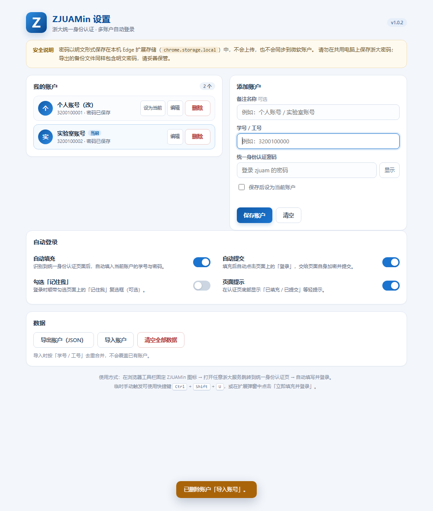
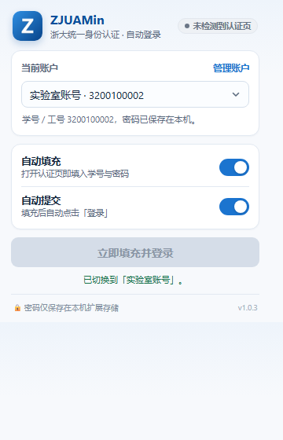
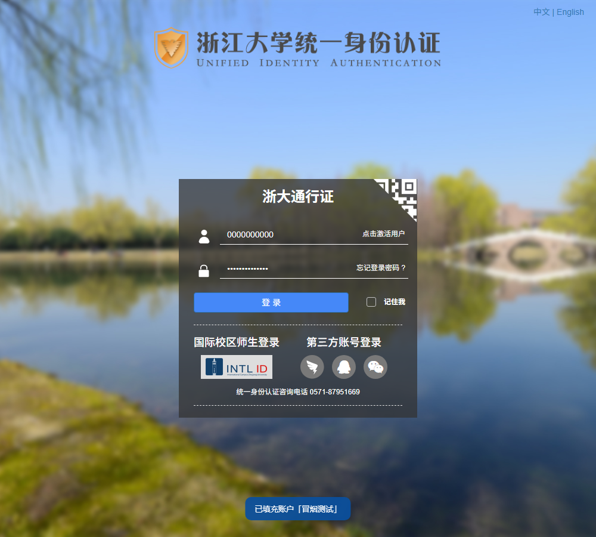

# ZJUAM-in：自动登录身份认证的 Edge 扩展

> 项目地址：<https://github.com/Lineus/ZJUAM-in>（MIT）
>
> Release 下载：<https://github.com/Lineus/ZJUAM-in/releases/tag/v1.0.3>

每次从教务、学在浙大、图书馆之类的地方被弹到浙大统一身份认证，流程都差不多：等页面加载 → 点输入框 → 输学号 → 输密码 → 点「登录」。浏览器的密码管理器通常只负责填、不负责点；如果同时有几个账号（比如常用账号和备用账号），还得来回切换。

所以我写了个只做这件事的 Edge 扩展 **ZJUAMin**：只要页面以 `https://zjuam.zju.edu.cn/` 开头，就自动填入当前账户的学号 / 工号和密码，然后点「登录」。

它不碰验证码，不重写学校的加密逻辑，也不向任何服务器发送数据。代码开源，欢迎审阅。

## 它做什么

- **自动填充 + 自动提交**：识别到 zjuam 登录页后，填入当前账户的学号 / 工号与密码，约 0.15 秒后自动点击页面上的「登录」。
- **多账户**：最多保存 20 个账户（备注名 + 学号 / 工号 + 密码，按学号去重）。在弹窗顶部的下拉框切换当前账户；切换后已打开的认证页会自动按新账户重新填充，但不会替你再次提交。
- **四个开关**：自动填充、自动提交、勾选「记住我」、页面提示，可以分别控制。
- **失败保护**：页面提示「用户名或密码错误」时，暂停该账户的自动提交（本机所有标签页 30 分钟内有效），避免反复失败触发学校账号保护；改好密码后点弹窗「立即填充并登录」或按一次快捷键即可强制重试。
- **验证码**：遇到验证码只填账号密码、不自动提交，由你手动完成。
- **手动触发**：弹窗里的「立即填充并登录」，或快捷键 `Ctrl + Shift + U`（可在 `edge://extensions/shortcuts` 改）。
- **导入 / 导出**：账户可导出为 JSON 备份，换机或重装时导入。

## 安装（Edge）

1. 从 Release 下载 `zjuamin-1.0.3.zip`，解压到一个固定目录（例如 `D:\Extensions\ZJUAMin`）。
2. 地址栏打开 `edge://extensions/`，打开左下角「开发人员模式」。
3. 点「加载解压缩的扩展」，选择包含 `manifest.json` 的那个文件夹（不是它的上一级）。
4. 建议点扩展图标旁的「图钉」，把它固定到工具栏。

> 同样适用于 Chrome 等 Chromium 浏览器（`chrome://extensions/`）。因为没上架扩展商店，需要用开发者模式加载。
>
> v1.0.3 起在清单里固定了扩展 ID，以后覆盖升级、更换目录、重新加载都不会再丢账户。如果你之前装过更早的版本，升级时需要移除旧扩展、重新加载新目录，并导入一份之前导出的账户备份；只有这一次。

## 首次使用

1. 点工具栏的 ZJUAMin 图标 →「添加第一个账户」（或「管理账户」）。
2. 填备注名（可选，例如「个人账号」）、学号 / 工号和统一身份认证密码，保存。唯一账户会自动成为当前账户。
3. 打开任意需要浙大登录的服务，跳转到 zjuam 认证页后，就会看到它自动填入并提交。

## 几个防呆设计

- **为什么密码错误要暂停**：CAS 对连续失败通常有风控或锁定策略。与其反复重试，不如先停下来让你改密码。暂停是按账户记录的，其他账户不受影响；30 分钟后或手动强制重试就会恢复。
- **为什么有验证码就不提交**：验证码本来就是为了区分人和脚本，扩展不应该绕过它。只把账号密码填好，剩下的交给你。
- **为什么点登录前要等约 0.15 秒**：填充动作会触发页面自己的 JS（比如清空旧的错误提示、同步表单状态），留一个很短的安全窗口；也顺便在这段时间里检查验证码是不是刚出现。

## 原理（可以跳过）

zjuam 登录页的密码不是明文提交的：页面上的 `login.js` 会先向 `/cas/v2/getPubKey` 取 RSA 公钥，把密码字符反转后做学校自己的 RSA 加密，再把密文填回表单并提交。

ZJUAMin 没有重新实现这套加密，而是：content script 用原生 setter 写入 `#username` / `#password` 并派发 `input` / `change` 事件，然后点击页面上真正的「登录」按钮 `#dl`，让学校页面自己的脚本完成取公钥、加密和提交。

这样做的好处是：即使学校换了公钥、改了加密细节，扩展也不用跟着更新；扩展自身也不会发起任何网络请求。同样因为不需要额外能力，它的权限只有 `storage`（保存账户）和 `scripting`（手动触发时向已打开的认证页补注入脚本），host 权限只有 `https://zjuam.zju.edu.cn/*`。

## 安全与隐私

- 账户和密码保存在本机的 `chrome.storage.local`（扩展自己的存储区），**不会上传、不会同步**到微软账户或任何服务器。
- 密码以**明文**保存在本机：Edge 扩展没有系统级密钥链 / DPAPI 接口可用，这是同类自动登录扩展的普遍取舍。请勿在公共或共用电脑上保存浙大密码；介意的话可以只在需要时临时启用。本机其他以你的 Windows 账号运行的程序，理论上也能读到浏览器存储，这和「浏览器保存密码」是同一类风险。
- 导出的 JSON 备份同样包含明文密码，用完请及时删除。
- 扩展不读取与登录无关的页面数据，不做统计埋点，不处理、不绕过验证码。
- 请遵守学校账号使用规定，不要保存或使用他人的账号密码。

## 已知限制

- 只在 `https://zjuam.zju.edu.cn/` 下生效；学校如果更换认证域名或大改登录页结构（`#fm1` / `#username` / `#password` / `#dl`），需要更新选择器。
- 需要验证码时不自动提交（设计如此）。
- 密码错误后会暂停该账户的自动提交，30 分钟内不能自动重试（可手动强制重试）。
- 未上架 Edge 加载项商店，需要开发者模式加载；不支持 Firefox / Safari。

## 测试情况

- 本地 mock CAS 端到端测试 **44 项**：多账户增删改 / 去重 / 导入导出 / 切换生效账户、自动填充与自动提交、填充到点击间隔 < 600ms、密码端到端解密一致、密码错误不重复提交、验证码只填不交、开关关闭后不填 / 不交等。
- 真实 `zjuam.zju.edu.cn` 冒烟测试 **11 项**：真实登录页识别、自动填充假账户、页面不跳转、密码框仍为明文（即没有提交任何内容）。
- 仓库里带测试脚本，可以自行复跑：`node tools/e2e/run.js`、`node tools/e2e/smoke-real.js`。

真实页面上的填充效果（测试用的是假账户，没有提交）：

## 最后

项目在 <https://github.com/Lineus/ZJUAM-in>，Release 下载：<https://github.com/Lineus/ZJUAM-in/releases/tag/v1.0.3>。

遇到 bug、有想加的功能，欢迎去仓库提 issue fork或在本帖回复；如果它帮你省了几秒钟，也欢迎点个 star。

本扩展与本文使用 Deepseek Harness（deepseek-v4.1-flash）辅助开发与撰写。

感谢阅读！